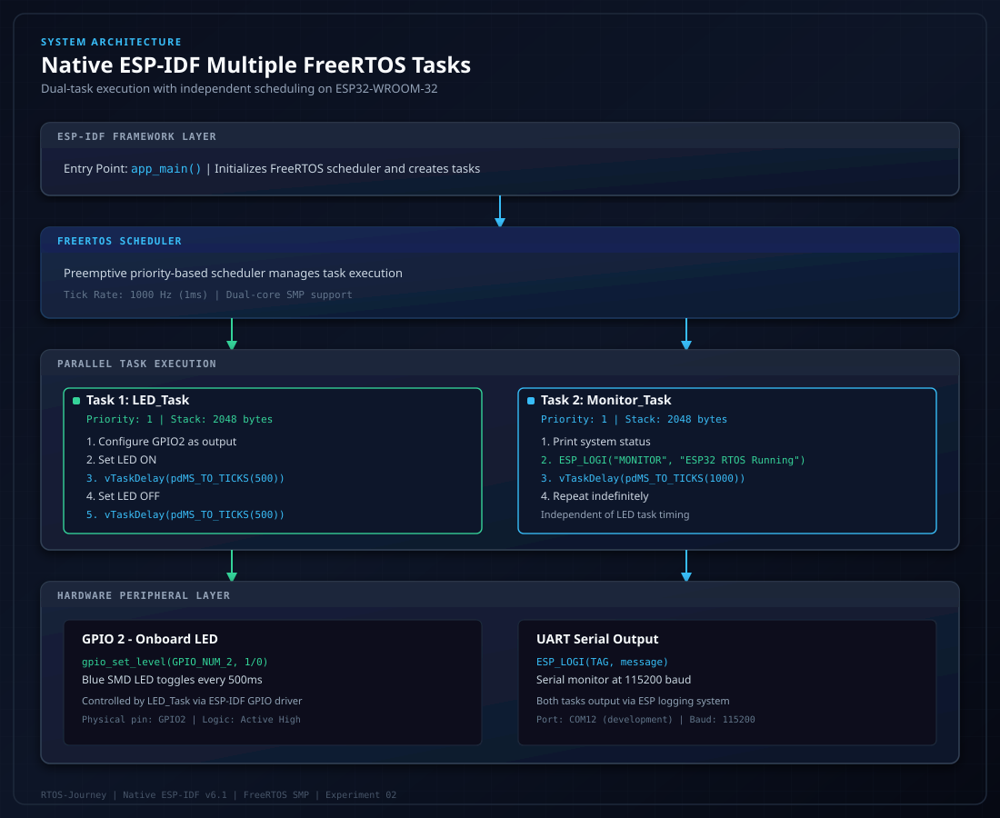
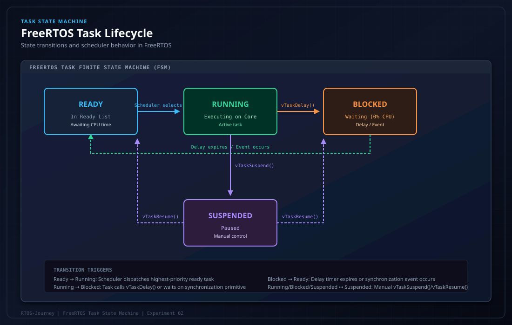
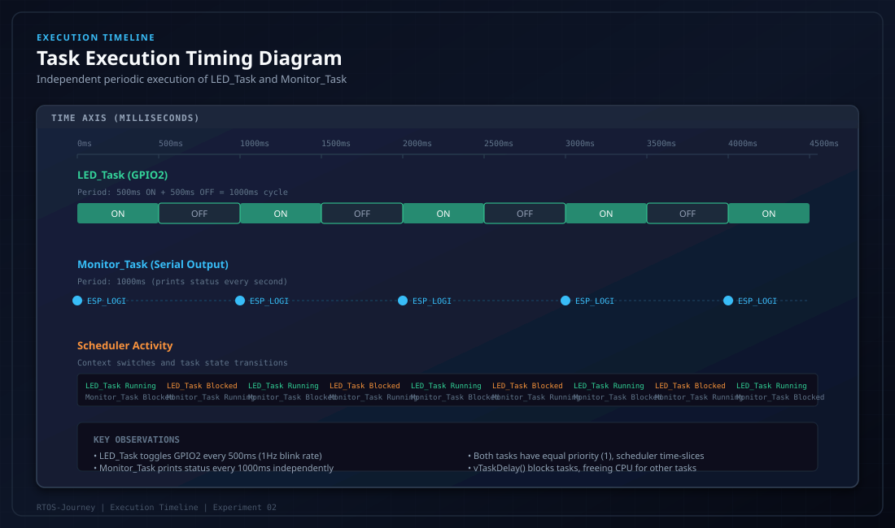
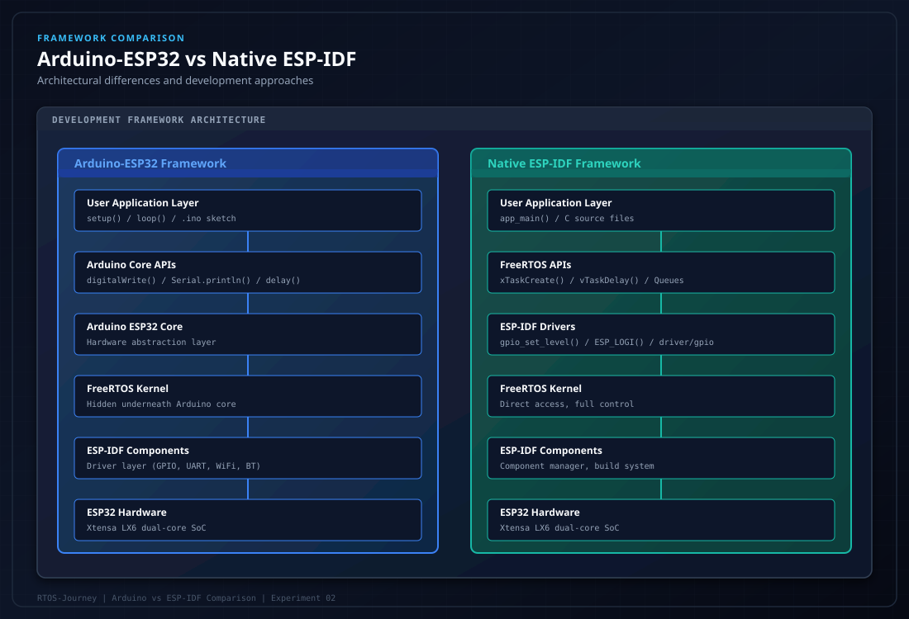

# Experiment 02: Native ESP-IDF Multiple FreeRTOS Tasks


> **Native ESP-IDF firmware development** with dual FreeRTOS tasks demonstrating independent scheduling, preemptive multitasking, and ESP-IDF driver integration on ESP32-WROOM-32.

---

## Project Overview

This experiment represents a significant advancement from Arduino-based FreeRTOS development to **native ESP-IDF firmware engineering**. While Experiment 01 introduced FreeRTOS concepts through the Arduino framework, this experiment demonstrates direct ESP-IDF development using the official Espressif IoT Development Framework.

The application creates **two independently scheduled FreeRTOS tasks** that execute concurrently:

- **LED_Task**: Controls the onboard GPIO2 LED with precise 500ms timing intervals
- **Monitor_Task**: Prints system status messages every 1000ms via the ESP logging system

Both tasks operate at equal priority (1) with 2048-byte stack allocations, demonstrating how the FreeRTOS scheduler manages concurrent execution through preemptive time-slicing and state transitions.



---

## Hardware Specifications

| Component | Specification / Details |
| :--- | :--- |
| **Microcontroller Board** | ESP32-WROOM-32 Development Board (30-pin / 38-pin) |
| **Processor Silicon** | Xtensa Dual-Core 32-bit LX6 Microprocessor @ 240 MHz |
| **Internal Memory** | 520 KB SRAM |
| **External Memory** | 4 MB Quad-SPI Flash |
| **Actuator Indicator** | Onboard Blue SMD LED connected to **GPIO 2** |
| **Interconnect** | Micro-USB / USB-C to USB-A programming & serial cable |
| **Development Port** | COM12 (specific to development computer) |

---

## Software & Toolchain

- **Framework**: ESP-IDF v6.1 (Native Espressif IoT Development Framework)
- **Kernel**: FreeRTOS Kernel (SMP dual-core support)
- **Build System**: CMake 3.22+ with Ninja backend
- **Headers**: `"freertos/FreeRTOS.h"`, `"freertos/task.h"`, `"driver/gpio.h"`, `"esp_log.h"`
- **IDE**: VS Code with ESP-IDF Extension / ESP-IDF Terminal
- **Monitor Baud Rate**: 115200 bps
- **Target**: ESP32

---

## System Architecture

### Native ESP-IDF Entry Point

Unlike Arduino's `setup()` and `loop()` structure, native ESP-IDF applications use `app_main()` as the single entry point. This function is called after ESP-IDF system initialization and FreeRTOS scheduler startup.

### Task Creation and Scheduling

The application creates two tasks using `xTaskCreate()`:

```c
xTaskCreate(
    ledTask,           // Task function pointer
    "LED_Task",        // Descriptive task name
    2048,              // Stack size in bytes
    NULL,              // Task parameter (unused)
    1,                 // Priority (1 = low, above Idle Task)
    NULL               // Task handle (optional)
);
```

Both tasks are registered with the FreeRTOS scheduler, which manages their execution based on priority, ready state, and tick-based timing.

### Task Descriptions

#### Task 1: LED_Task
- **Function**: `ledTask(void *parameter)`
- **Purpose**: Configure GPIO2 as output and toggle the onboard LED
- **Timing**: 500ms ON, 500ms OFF (1Hz blink rate)
- **APIs Used**: `gpio_reset_pin()`, `gpio_set_direction()`, `gpio_set_level()`, `vTaskDelay()`
- **Stack**: 2048 bytes
- **Priority**: 1

#### Task 2: Monitor_Task
- **Function**: `monitorTask(void *parameter)`
- **Purpose**: Print periodic system status messages
- **Timing**: 1000ms interval
- **APIs Used**: `ESP_LOGI()`, `vTaskDelay()`
- **Stack**: 2048 bytes
- **Priority**: 1

---

## Source Code Explanation

### Complete Source Code

```c
#include "freertos/FreeRTOS.h"
#include "freertos/task.h"

#include "driver/gpio.h"
#include "esp_log.h"

#define LED_PIN GPIO_NUM_2

static const char *TAG = "RTOS_DEMO";

// Task 1: LED blinking
void ledTask(void *parameter)
{
    gpio_reset_pin(LED_PIN);
    gpio_set_direction(LED_PIN, GPIO_MODE_OUTPUT);

    while (1)
    {
        gpio_set_level(LED_PIN, 1);
        ESP_LOGI(TAG, "LED ON");

        vTaskDelay(pdMS_TO_TICKS(500));

        gpio_set_level(LED_PIN, 0);
        ESP_LOGI(TAG, "LED OFF");

        vTaskDelay(pdMS_TO_TICKS(500));
    }
}

// Task 2: Serial monitoring
void monitorTask(void *parameter)
{
    while (1)
    {
        ESP_LOGI("MONITOR", "ESP32 RTOS Running");

        vTaskDelay(pdMS_TO_TICKS(1000));
    }
}

// Native ESP-IDF entry point
void app_main(void)
{
    ESP_LOGI(TAG, "Starting Multiple RTOS Tasks");

    xTaskCreate(
        ledTask,
        "LED_Task",
        2048,
        NULL,
        1,
        NULL
    );

    xTaskCreate(
        monitorTask,
        "Monitor_Task",
        2048,
        NULL,
        1,
        NULL
    );
}
```

### Key Implementation Details

#### 1. GPIO Configuration (ESP-IDF Driver)
```c
gpio_reset_pin(LED_PIN);
gpio_set_direction(LED_PIN, GPIO_MODE_OUTPUT);
```
- `gpio_reset_pin()`: Resets the GPIO to its default state
- `gpio_set_direction()`: Configures GPIO2 as output mode
- Unlike Arduino's `pinMode()`, ESP-IDF uses explicit driver APIs with error handling

#### 2. GPIO Control
```c
gpio_set_level(LED_PIN, 1);  // LED ON
gpio_set_level(LED_PIN, 0);  // LED OFF
```
- `gpio_set_level()`: Sets the GPIO output level (1 = HIGH, 0 = LOW)
- Direct hardware register access through ESP-IDF GPIO driver

#### 3. ESP Logging System
```c
ESP_LOGI(TAG, "LED ON");
ESP_LOGI("MONITOR", "ESP32 RTOS Running");
```
- `ESP_LOGI()`: Info-level logging with tag-based categorization
- More sophisticated than Arduino's `Serial.println()` with log levels (E, W, I, D, V)
- Integrated with ESP-IDF's unified logging framework

#### 4. Task Delay
```c
vTaskDelay(pdMS_TO_TICKS(500));
```
- `pdMS_TO_TICKS()`: Converts milliseconds to FreeRTOS ticks
- `vTaskDelay()`: Blocks the task for the specified tick count
- Task enters **Blocked** state, freeing CPU for other tasks

---

## API Reference Table

| API | Purpose | Parameters | Return Value |
| :--- | :--- | :--- | :--- |
| `xTaskCreate()` | Create a new FreeRTOS task | Function pointer, name, stack size, parameter, priority, handle | `pdPASS` on success, `errCOULD_NOT_ALLOCATE_REQUIRED_MEMORY` on failure |
| `vTaskDelay()` | Block task for specified ticks | Tick count (converted via `pdMS_TO_TICKS()`) | None (void) |
| `pdMS_TO_TICKS()` | Convert milliseconds to ticks | Milliseconds (portTickType) | Tick count (TickType_t) |
| `gpio_reset_pin()` | Reset GPIO to default state | GPIO number (gpio_num_t) | ESP_OK on success |
| `gpio_set_direction()` | Set GPIO direction | GPIO number, mode (GPIO_MODE_INPUT/OUTPUT) | ESP_OK on success |
| `gpio_set_level()` | Set GPIO output level | GPIO number, level (0 or 1) | ESP_OK on success |
| `ESP_LOGI()` | Log info-level message | Tag string, format string, variable arguments | None (void) |

---

## Task Lifecycle Visualization



### Task States Explained

- **Ready**: Task is prepared to execute and is in the scheduler's ready list, awaiting CPU time
- **Running**: Task is actively executing on a CPU core
- **Blocked**: Task is waiting for a temporal event (`vTaskDelay()`) or synchronization primitive (Queue, Semaphore)
- **Suspended**: Task is manually paused via `vTaskSuspend()` and will not execute until resumed

### State Transitions in This Experiment

1. **Ready → Running**: Scheduler selects the highest-priority ready task
2. **Running → Blocked**: Task calls `vTaskDelay()` and enters the delayed task list
3. **Blocked → Ready**: Delay timer expires (SysTick ISR detects elapsed time)
4. Both tasks continuously cycle through Ready → Running → Blocked states

---

## Execution Timeline



### Timing Analysis

- **LED_Task**: Toggles GPIO2 every 500ms (ON for 500ms, OFF for 500ms)
- **Monitor_Task**: Prints status every 1000ms
- **Scheduler**: Context-switches between tasks based on priority and ready state
- **Independence**: Tasks execute independently; Monitor_Task timing does not affect LED_Task timing

### Observed Behavior

- LED blinks at 1Hz (50% duty cycle)
- Monitor output appears every second
- Both tasks output via ESP logging system
- No fixed message ordering between tasks due to independent scheduling

---

## Build, Flash and Monitor Instructions

### Prerequisites

1. **Install ESP-IDF v6.1**:
   ```bash
   # Follow official Espressif setup guide for your OS
   # https://docs.espressif.com/projects/esp-idf/en/v6.1/esp32/get-started/index.html
   ```

2. **Set up ESP-IDF environment**:
   ```bash
   # Windows (Command Prompt)
   %USERPROFILE%\.espressif\esp-idf\install.bat
   %USERPROFILE%\.espressif\esp-idf\export.bat

   # Linux/macOS
   source ~/esp/esp-idf/export.sh
   ```

### Build Commands

Navigate to the project directory:
```bash
cd 02_ESP32_Native_ESP_IDF_Multiple_Tasks
```

Set target to ESP32:
```bash
idf.py set-target esp32
```

Build the project:
```bash
idf.py build
```

### Flash and Monitor

Flash firmware to ESP32 and open serial monitor:
```bash
idf.py -p COM12 flash monitor
```

**Important**: Replace `COM12` with your actual USB-to-UART port (e.g., `COM3`, `COM4`, `/dev/ttyUSB0`, `/dev/tty.usbserial-...`).

### Monitor Only (if already flashed)

```bash
idf.py -p COM12 monitor
```

Press `Ctrl+]` to exit the monitor.

---

## Expected Serial Output

### Serial Monitor (115200 baud)

```text
I (123) main: Starting Multiple RTOS Tasks
I (133) RTOS_DEMO: LED ON
I (633) RTOS_DEMO: LED OFF
I (1133) MONITOR: ESP32 RTOS Running
I (1233) RTOS_DEMO: LED ON
I (1733) RTOS_DEMO: LED OFF
I (2133) MONITOR: ESP32 RTOS Running
I (2233) RTOS_DEMO: LED ON
I (2733) RTOS_DEMO: LED OFF
I (3133) MONITOR: ESP32 RTOS Running
...
```

### Output Analysis

- `I (xxx) TAG: message` format indicates info-level log with timestamp in milliseconds
- LED_Task logs "LED ON" and "LED OFF" every 500ms
- Monitor_Task logs "ESP32 RTOS Running" every 1000ms
- Timestamps show independent task execution

---

## Memory Usage Report

### Observed Build Report

| Memory Region | Usage | Percentage |
| :--- | :--- | :--- |
| **Flash Code** | 55,642 bytes | N/A |
| **IRAM** | 44,127 bytes | 33.67% |
| **DRAM** | 13,650 bytes | 7.55% |
| **RTC SLOW** | 64 bytes | N/A |
| **Total Image Size** | 147,767 bytes | N/A |

**Note**: These values are from the observed successful build on the development system. Actual usage may vary based on ESP-IDF configuration and compiler optimizations.

### Stack Allocation

- **LED_Task Stack**: 2048 bytes
- **Monitor_Task Stack**: 2048 bytes
- **Total Task Stack**: 4096 bytes
- Stack sizes are conservative; actual usage is typically lower for simple tasks

---

## Technical Learnings

### 1. Native ESP-IDF vs Arduino Framework



**Arduino-ESP32**:
- Entry points: `setup()` and `loop()`
- Simplified APIs: `digitalWrite()`, `Serial.println()`
- FreeRTOS hidden underneath Arduino core
- Easier for beginners, less control

**Native ESP-IDF**:
- Entry point: `app_main()`
- Direct driver APIs: `gpio_set_level()`, `ESP_LOGI()`
- Full FreeRTOS API access
- Professional firmware development, complete control

### 2. FreeRTOS Task Fundamentals

**What is a FreeRTOS Task?**
A task is an independent thread of execution with its own stack, program counter, and register context. Tasks are scheduled preemptively by the FreeRTOS kernel based on priority and ready state.

**Task Control Block (TCB)**
The TCB is a data structure maintained by FreeRTOS that stores task metadata:
- Task name and priority
- Stack pointer and stack limits
- Task state (Ready, Running, Blocked, Suspended)
- Task handle for external reference

### 3. Task Scheduling and Preemption

**Preemptive Scheduling**
FreeRTOS uses a preemptive, priority-based scheduler. Higher-priority tasks always preempt lower-priority tasks. Tasks of equal priority are time-sliced via tick interrupts.

**Concurrency vs Parallelism**
- **Concurrency**: Tasks appear to execute simultaneously through rapid context switching
- **Parallelism**: Tasks execute simultaneously on multiple CPU cores
- On dual-core ESP32, tasks can truly run in parallel if pinned to different cores

### 4. vTaskDelay() and Blocking

When a task calls `vTaskDelay()`:
1. Task is removed from the ready list
2. Task is placed in the delayed task list with a wake time
3. CPU core is freed for other ready tasks
4. SysTick ISR checks delayed tasks and moves expired tasks back to ready list
5. Task resumes execution when selected by scheduler

This is **non-blocking delay**—unlike Arduino's `delay()` which busy-waits and blocks the entire CPU.

### 5. pdMS_TO_TICKS() Conversion

`pdMS_TO_TICKS(500)` converts 500 milliseconds to FreeRTOS ticks based on `configTICK_RATE_HZ` (typically 1000 Hz on ESP32, meaning 1 tick = 1ms). This ensures timing accuracy regardless of tick rate configuration.

### 6. ESP-IDF GPIO Driver vs Arduino GPIO

**Arduino GPIO**:
```c
pinMode(2, OUTPUT);
digitalWrite(2, HIGH);
```
- Simple, beginner-friendly
- Limited error handling
- Abstraction layer overhead

**ESP-IDF GPIO**:
```c
gpio_reset_pin(GPIO_NUM_2);
gpio_set_direction(GPIO_NUM_2, GPIO_MODE_OUTPUT);
gpio_set_level(GPIO_NUM_2, 1);
```
- Explicit control with error codes
- Direct hardware access
- Production-grade reliability

### 7. ESP_LOGI() vs Serial.println()

**Serial.println()**:
- Basic text output
- No log levels
- Blocking on some platforms

**ESP_LOGI()**:
- Tag-based categorization
- Multiple log levels (Error, Warning, Info, Debug, Verbose)
- Non-blocking with ring buffer
- Integrated with ESP-IDF monitoring tools

---

## Future Improvements

- [ ] **Task Priority Experimentation**: Create tasks with different priorities to observe preemption behavior
- [ ] **Core Pinning**: Use `xTaskCreatePinnedToCore()` to bind tasks to specific CPU cores
- [ ] **Stack Analysis**: Use `uxTaskGetStackHighWaterMark()` to monitor actual stack usage
- [ ] **Inter-Task Communication**: Implement FreeRTOS Queues to pass data between tasks
- [ ] **Synchronization**: Add Binary Semaphores for hardware interrupt synchronization
- [ ] **Mutex Protection**: Demonstrate shared resource protection with Mutexes
- [ ] **Software Timers**: Replace periodic delays with FreeRTOS Software Timers
- [ ] **Task Notifications**: Use lightweight task notifications for signaling

---

## Troubleshooting

### Build Errors

**"idf.py not found"**:
- Ensure ESP-IDF environment is properly sourced/exported
- Verify ESP-IDF installation path

**"Target not set"**:
- Run `idf.py set-target esp32` before building

### Flash Errors

**"Failed to connect"**:
- Check USB cable connection
- Verify COM port is correct
- Try pressing BOOT button during flashing
- Reduce upload speed if using high baud rates

### Runtime Issues

**LED not blinking**:
- Verify GPIO2 is correct for your board
- Check solder connections on custom boards
- Monitor serial output for error messages

**No serial output**:
- Verify baud rate is 115200
- Check COM port selection
- Ensure USB-to-UART driver is installed

---

## References

- [ESP-IDF Programming Guide v6.1](https://docs.espressif.com/projects/esp-idf/en/v6.1/esp32/)
- [FreeRTOS Official Documentation](https://www.freertos.org/Documentation.html)
- [ESP32 Technical Reference Manual](https://www.espressif.com/sites/default/files/documentation/esp32_technical_reference_en.pdf)
- [ESP-IDF GPIO Driver Guide](https://docs.espressif.com/projects/esp-idf/en/v6.1/esp32/api-reference/peripherals/gpio.html)

---

## License

This experiment is part of the RTOS-Journey project, licensed under the [MIT License](../LICENSE).
