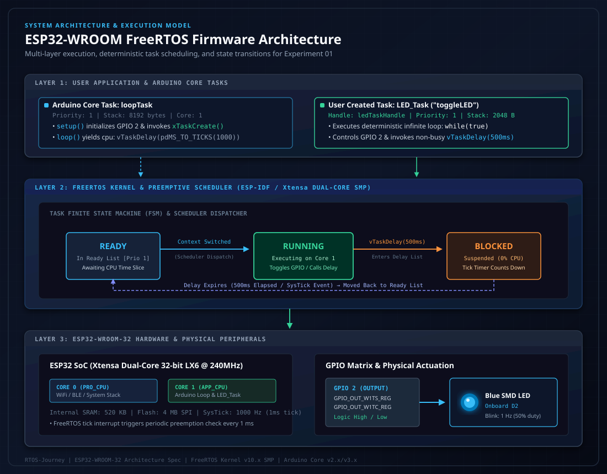

# RTOS Journey

> Practical exploration of Real-Time Operating Systems, task scheduling, synchronization, memory management and embedded firmware development.

---

## Overview

Welcome to **RTOS Journey** — a repository documenting hands-on embedded firmware development using **FreeRTOS** on real-time microcontrollers. The goal of this repository is to systematically progress from foundational multi-tasking and deterministic scheduling to advanced inter-task communication (IPC), concurrency management, resource arbitration, and real-time hardware peripheral control.

All experiments are engineered with clean code practices, production-minded stack and memory configurations, comprehensive technical documentation, and vector architectural diagrams.

---

## Architectural Foundation

FreeRTOS operates as a preemptive, priority-driven real-time kernel. On the Espressif **ESP32-WROOM-32**, the FreeRTOS implementation runs on dual Xtensa LX6 cores with Symmetric Multiprocessing (SMP) support:



---

## Hardware Platforms & Toolchain

### Target Hardware
- **Primary Platform**: Espressif ESP32-WROOM-32 (Xtensa Dual-Core 32-bit LX6 @ 240 MHz, 520 KB SRAM, 4 MB Flash)
- **Secondary Platforms** (Roadmap): STM32 ARM Cortex-M series, Raspberry Pi RP2040

### Software & Frameworks
- **Kernel**: FreeRTOS Kernel (SMP port)
- **Framework**: Arduino-ESP32 / ESP-IDF Core
- **Development Environments**: Arduino IDE 2.x, PlatformIO, VS Code
- **Serial Debugging**: 115200 bps UART Telemetry

---

## Experiment Repository Index

| # | Experiment Name | Focus Area | Status | Directory Link |
| :-: | :--- | :--- | :-: | :--- |
| **01** | **ESP32 FreeRTOS LED Blink** | Task Creation, Preemption, State FSM, `vTaskDelay()` | Completed | [01_ESP32_FreeRTOS_LED_Blink](./01_ESP32_FreeRTOS_LED_Blink/) |
| **02** | **Multi-Task Scheduling & Concurrency** | Dual tasks, independent rates, core affinity (`PinnedToCore`) | Planned | *Upcoming* |
| **03** | **Task Priorities & Preemption** | Priority inversions, starvation, tick-based time slicing | Planned | *Upcoming* |
| **04** | **Queue Management & IPC** | Safe cross-task message passing, FIFO buffers, telemetry | Planned | *Upcoming* |
| **05** | **Binary & Counting Semaphores** | Hardware interrupt synchronization (ISR to Task handoff) | Planned | *Upcoming* |
| **06** | **Mutexes & Shared Resource Arbitration** | Critical section guarding, Priority Inheritance | Planned | *Upcoming* |
| **07** | **Software Timers & Watchdogs** | One-shot and auto-reload timers, task health monitoring | Planned | *Upcoming* |
| **08** | **Event Groups & Task Notifications** | Low-overhead flags, multi-event barrier synchronization | Planned | *Upcoming* |

---

## Completed Experiments

### [Experiment 01: ESP32 FreeRTOS LED Blink](./01_ESP32_FreeRTOS_LED_Blink/)
- **Objective**: Transition from blocking bare-metal delays (`delay()`) to non-blocking preemptive FreeRTOS tasks.
- **Key Concepts**: `xTaskCreate()`, task stack sizing (2048 bytes), task priorities, task finite state machine (Running, Blocked, Ready), `vTaskDelay()`, `pdMS_TO_TICKS()`, and Arduino core's `loopTask` relationship.
- **Hardware Validated**: ESP32-WROOM-32 onboard blue LED on GPIO 2 blinking at a deterministic 1 Hz rate.

---

## Repository Structure

```text
RTOS-Journey/
│
├── README.md                                 # Root repository overview and syllabus
├── LICENSE                                   # MIT License
│
├── assets/
│   └── esp32_freertos_architecture.svg       # Vector diagram of FreeRTOS task & memory layers
│
└── 01_ESP32_FreeRTOS_LED_Blink/              # Experiment 01
    ├── README.md                             # In-depth technical breakdown and execution guide
    └── led_blink_esp32_wroom.ino             # Production-commented Arduino/FreeRTOS source
```

---

## Roadmap

- [x] Experiment 01: Single-Task FreeRTOS LED Blinker with State Transitions
- [ ] Experiment 02: Multi-Task Asynchronous Blinking & Core Pinning
- [ ] Experiment 03: Task Priority Dynamics, Preemption & Starvation Analysis
- [ ] Experiment 04: Inter-Task Communication via FreeRTOS Queues
- [ ] Experiment 05: External GPIO Interrupts synchronized via Binary Semaphores
- [ ] Experiment 06: Mutex Protection for Shared UART Serial Bus
- [ ] Experiment 07: Software Timer Service Daemons & Watchdog Implementation
- [ ] Experiment 08: Direct-to-Task Notifications (Lightweight IPC)

---

## Author & Maintainer

**Priyadharsan D**
- GitHub: [@PRIY4DH4RS4N-D](https://github.com/PRIY4DH4RS4N-D)
- Focus: Embedded Systems, VLSI, Real-Time Operating Systems (RTOS), Firmware Engineering

---

## License

This project is licensed under the [MIT License](./LICENSE). Feel free to use, modify, and reference for embedded systems learning and development.
